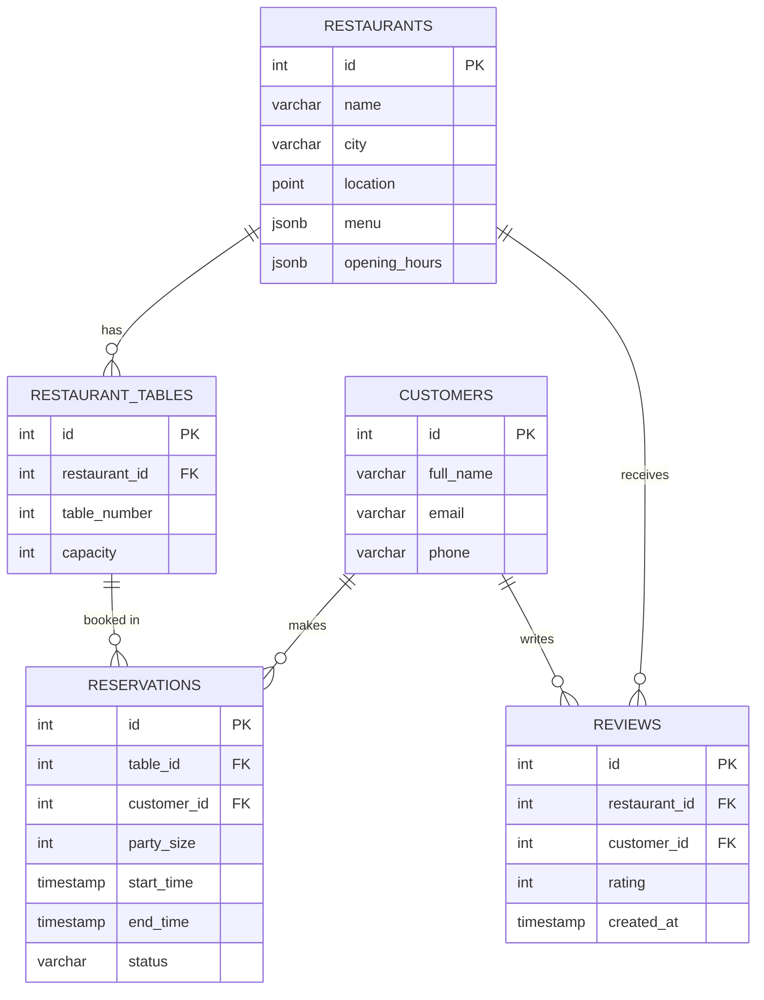

# Restaurant Reservation and Review System Backend

Backend for booking restaurant tables and storing reviews, using PostgreSQL, Redis and MongoDB with Python.

| Database | Used for |
|---|---|
| PostgreSQL | Restaurants, tables, customers, reservations, review ratings. Menus and opening hours are stored as JSONB |
| Redis | Caching table availability for time slots |
| MongoDB | Long-form review text |

## Requirements

- Python 3.14
- PostgreSQL 18
- Redis (on Windows: Memurai Developer)
- MongoDB Community Server

## Setup

1. Create and activate a virtual environment, then install packages:

   ```powershell
   python -m venv .venv
   .\.venv\Scripts\Activate.ps1
   pip install -r requirements.txt
   ```

2. Create the database:

   ```powershell
   psql -U postgres -c "CREATE DATABASE reservation_db;"
   ```

3. Create the tables and load sample data:

   ```powershell
   psql -U postgres -d reservation_db -f schema.sql
   psql -U postgres -d reservation_db -f seed.sql
   ```

4. Create a `.env` file in the project folder (it is not committed to Git):

   ```
   DB_HOST=localhost
   DB_PORT=5432
   DB_NAME=reservation_db
   DB_USER=postgres
   DB_PASSWORD=your_password_here
   ```

   Redis and MongoDB use their default local ports. To change them, add `REDIS_HOST`, `REDIS_PORT` or `MONGO_URI`.

5. For the performance tests, load the large data set and the indexes:

   ```powershell
   psql -U postgres -d reservation_db -f bulk_data.sql
   psql -U postgres -d reservation_db -f indexes.sql
   ```

## Project files

| File | Purpose |
|---|---|
| `schema.sql` | Creates the 5 tables with keys and constraints |
| `seed.sql` | Sample data: 4 restaurants in Kigali and Musanze, 12 tables, 4 customers |
| `bulk_data.sql` | Large test data: 1,000 restaurants, 10,000 tables, 300,000 reservations |
| `indexes.sql` | B-tree indexes on time slots and capacity, GiST index on location |
| `queries.sql` | CTE availability query, `RANK()` per city, `EXPLAIN ANALYZE`, nearest restaurants |
| `db.py` | PostgreSQL connection pool |
| `booking.py` | Atomic reservation booking |
| `cache.py` | Redis cache for table availability |
| `reviews.py` | Reviews: rating in PostgreSQL, long text in MongoDB |
| `test_concurrency.py` | Five customers try to book the same table at the same time |
| `er_diagram.md` | ER diagram (Mermaid) |
| `requirements.txt` | Python packages |

## How to run

Activate the virtual environment first, then:

| Command | What it shows |
|---|---|
| `python db.py` | The connection pool works and prints the restaurant count (4 with `seed.sql`, 1,004 after `bulk_data.sql`) |
| `python booking.py` | An overlapping booking is refused, a free one succeeds, a too-small table is refused |
| `python test_concurrency.py` | Only 1 of 5 simultaneous bookings succeeds |
| `python cache.py` | First check comes from PostgreSQL, the second from Redis |
| `python reviews.py` | Saves a review and lists the restaurant's reviews from MongoDB |
| `psql -U postgres -d reservation_db -f queries.sql` | Runs all analytical queries |

Running `booking.py` or `test_concurrency.py` a second time gives different results, because the slots are already booked. Run `seed.sql` again to reset.

## Schema



The schema is in 3NF:

- `reservations` links to a table, not a restaurant. The restaurant is found through the table, so it is stored only once.
- Review ratings are in PostgreSQL so they can be averaged and ranked with SQL. The long review text is in MongoDB.

## Reservation booking

`book_table()` in `booking.py` runs as one transaction:

1. Lock the table's row with `SELECT ... FOR UPDATE`. Other bookings for the same table wait here.
2. Check the table has enough seats.
3. Check no confirmed booking overlaps the requested time: `start_time < requested_end AND end_time > requested_start`.
4. Insert the reservation and commit. On any failure, roll back.

All queries are parameterized (`%s`), so user input is never run as SQL.

`test_concurrency.py` starts 5 threads at the same moment, all booking the same table and time. Result: 1 booking succeeds and 4 are refused.

## Redis and MongoDB

- **Redis:** `is_table_available()` checks Redis first. On a miss it asks PostgreSQL and caches the answer for 60 seconds. After a successful booking, all cached slots for that table are deleted. The booking itself always checks PostgreSQL, never the cache.
- **MongoDB:** `add_review()` inserts the rating in PostgreSQL, then the text in MongoDB, then commits. If MongoDB fails, the rating is rolled back. The documents link to PostgreSQL through `review_id`.

## Performance

Measured on 300,000 reservations, using query 3 in `queries.sql` (free tables for 4 people on 15 Dec, 19:00–21:00):

| | Before indexes | After indexes |
|---|---|---|
| Reservations scan | `Seq Scan`, 290,005 rows removed | `Bitmap Index Scan on idx_reservations_time` |
| Buffers read | 2,884 | 224 |
| Execution time | 33.7 ms | 6.7 ms |

- `idx_reservations_time` on `(start_time, end_time)` made the query about 5 times faster.
- `idx_tables_capacity` was not used for `capacity >= 4`, because that matches about 60% of tables and a sequential scan is cheaper. It helps for more selective filters such as `capacity >= 8`.
- `idx_restaurants_location` (GiST) changed the nearest-restaurants query (query 4) from a full scan plus sort to an index scan: 0.296 ms to 0.029 ms on 1,004 restaurants.

## Known limitations

- PostgreSQL and MongoDB cannot share a transaction. If the PostgreSQL commit fails after MongoDB saved a review, the text is left without a rating.
- If Redis is down after a booking is committed, `clear_table_cache()` raises an error even though the booking was saved.
- `POINT` distance (`<->`) is in degrees, not kilometres. PostGIS would be needed for real distances.
- Locations in `bulk_data.sql` are random and do not match the city names.
