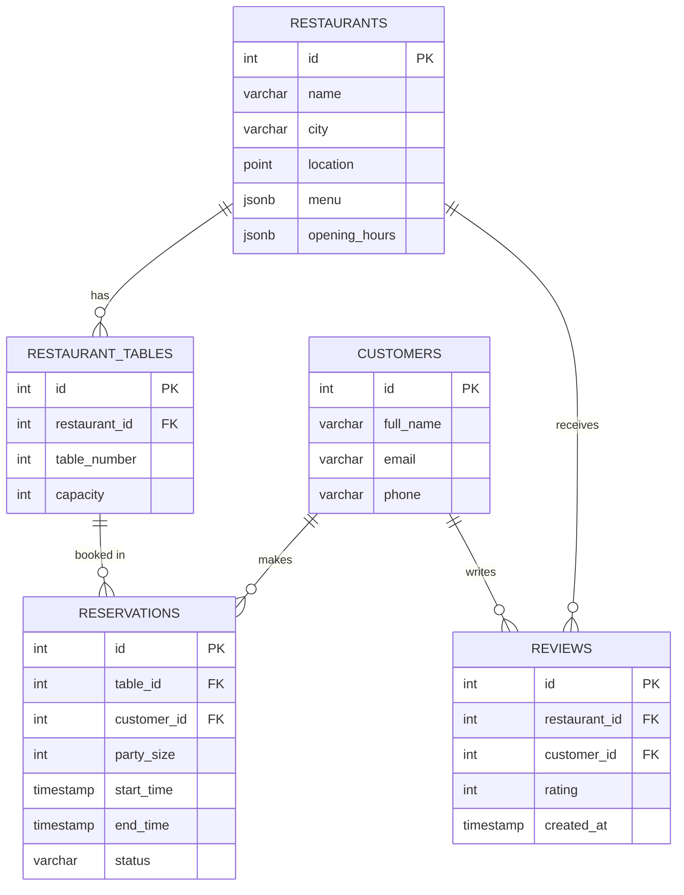

# Restaurant Reservation and Review System Backend

Backend for booking restaurant tables and storing reviews, using PostgreSQL, Redis and MongoDB with Python.

| Database | Used for |
|---|---|
| PostgreSQL | Restaurants, tables, customers, reservations, review ratings. Menus and opening hours are stored as JSONB |
| Redis | Caching table availability for time slots |
| MongoDB | Long-form review text |

## Requirements

- Python 3.14
- PostgreSQL 18
- Redis (on Windows: Memurai Developer)
- MongoDB Community Server

## Setup

1. Create and activate a virtual environment, then install packages:

   ```powershell
   python -m venv .venv
   .\.venv\Scripts\Activate.ps1
   pip install -r requirements.txt
   ```

2. Create the database:

   ```powershell
   psql -U postgres -c "CREATE DATABASE reservation_db;"
   ```

3. Create the tables and load sample data:

   ```powershell
   psql -U postgres -d reservation_db -f schema.sql
   psql -U postgres -d reservation_db -f seed.sql
   ```

## Project files

| File | Purpose |
|---|---|
| `schema.sql` | Creates the 5 tables with keys and constraints |
| `seed.sql` | Sample data: 4 restaurants in Kigali and Musanze, 12 tables, 4 customers |
| `er_diagram.md` | ER diagram (Mermaid) |
| `requirements.txt` | Python packages |

## Schema



The schema is in 3NF:

- `reservations` links to a table, not a restaurant. The restaurant is found through the table, so it is stored only once.
- Review ratings are in PostgreSQL so they can be averaged and ranked with SQL. The long review text is in MongoDB.
